<div align="center">

# Forge

### Procedures for BrowserOps

**Teach a browser flow once, then replay it without the agent.**

Forge compiles one recorded agent run into a deterministic [BrowserOps](https://browserops.ai) procedure.
**Forge Hub** is a registry where procedures earn trust from verified runs, are demoted when the site drifts, and are healed from the live page.


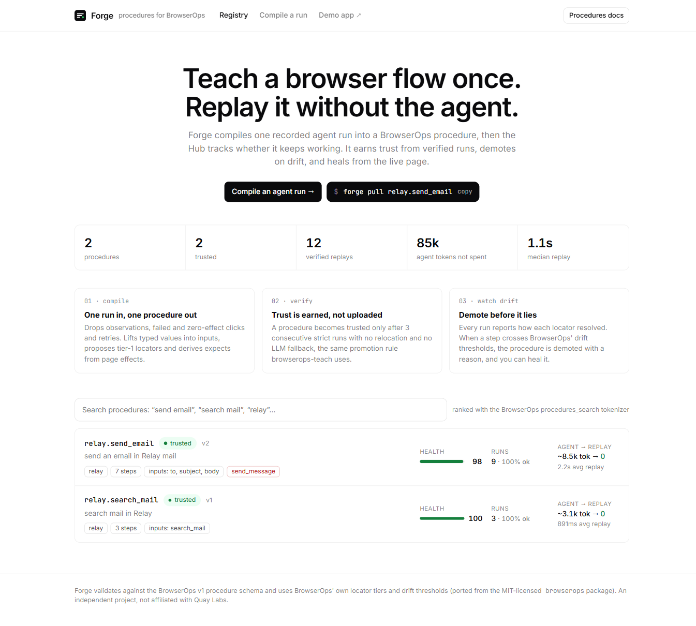

</div>

```
17 recorded tool calls  ──compile──▶  7 deterministic steps  ──verify ×3──▶  trusted
~8.5k agent tokens                    0 LLM tokens / replay              ──site redesign──▶ demoted (with reason)
                                                                         ──heal──▶ v2 ──verify ×3──▶ trusted
```

## Contents

- [Quick start](#quick-start)
- [Demo](#demo)
- [How it works](#how-it-works)
- [Architecture](#architecture)
- [CLI](#cli)
- [Why I built this](#why-i-built-this)
- [Tested on the live runtime](#tested-on-the-live-runtime)
- [Honest notes](#honest-notes)
- [What I'd build next](#what-id-build-next)

## Quick start

Requires **Node ≥ 22.13** (for `node:sqlite`).

```bash
npm install
npx playwright install chromium

npm run demo                    # full lifecycle in a real headless browser (≈1 min)
npm run build && npm run hub    # Hub UI at http://127.0.0.1:4317
npm test                        # 38 tests: core, live-runtime + real-site compat, Hub API, real-browser runner
```

| Command | What it does |
|---|---|
| `npm run demo` | Record → compile → publish → verify → drift → heal, end to end |
| `npm run demo -- --no-heal` | Stop after the procedure is demoted, so you can inspect the drift UI |
| `npm run demo -- --headed --serve` | Watch the browser and keep the Hub running afterwards |
| `npm run hub` | Serve the Hub (API + built UI + demo app) on port `4317` |
| `npm run hub:dev` | Hub server + Vite dev server with hot reload |
| `npm run forge -- <cmd>` | Run the [CLI](#cli) from inside the repo |

## Demo

<p align="center">
  
  <br><sub>43-second walkthrough · <a href="docs/media/forge-walkthrough.mp4">full-quality MP4</a> · regenerate with <code>npx tsx scripts/capture-media.ts full</code></sub>
</p>

`npm run demo` drives a real headless Chromium against **Relay Mail**, a small bundled app. A scripted "agent" sends an email the messy way real agents do: a dead Refresh click, a stale ref, a typo it retypes, screenshots and re-reads. Forge then runs the whole lifecycle.

<p align="center">
  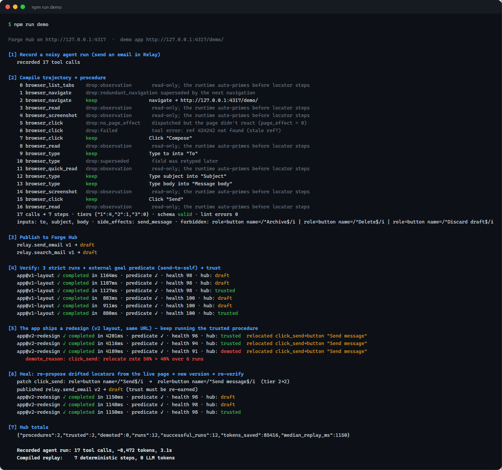
</p>

### 1. Compile: 17 noisy calls become 7 steps

Paste a trajectory into the Hub (or use `forge compile`). Each dropped call shows why it was dropped; each kept call shows the step it became.

<p align="center">
  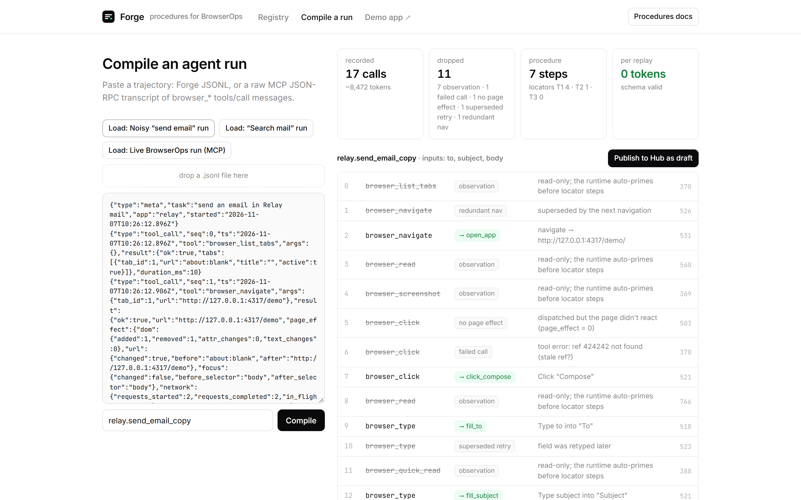
</p>

### 2. The site ships a redesign

The demo app serves a v2 layout at the **same URL**: "Compose" becomes "New message" and "Send" becomes "Send message".

| v1 layout | v2 "redesign" |
|---|---|
| 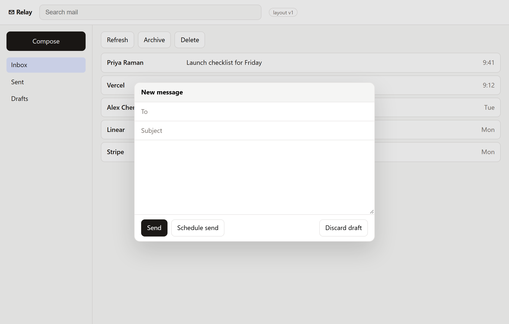 | 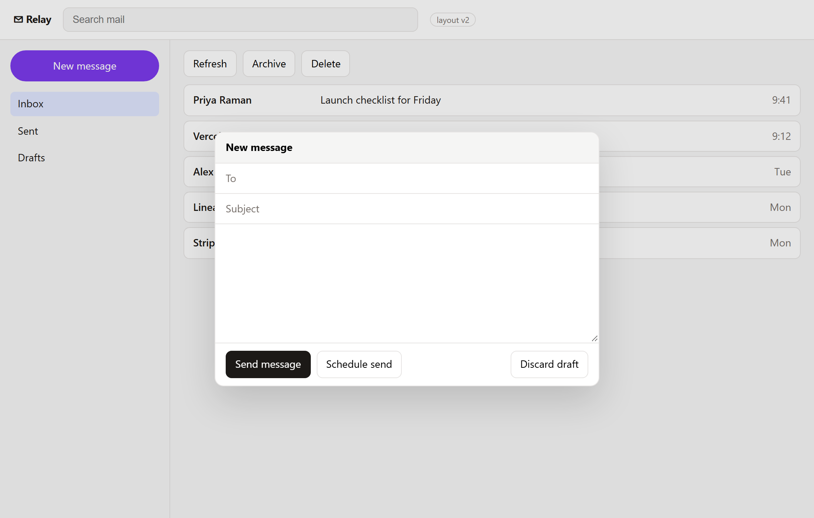 |

`click_compose` was bound to `data-testid` (tier 1), so it survives the copy change. Only the copy-derived Send locator (tier 2) drifts. That is the locator tier model doing its job.

### 3. Drift is caught: the procedure is demoted, with a reason

Runs still *complete* through relocation, but the Send step relocates 50% of the time, which is above BrowserOps' 40% threshold. The Hub demotes the procedure and shows exactly which step drifted.

<p align="center">
  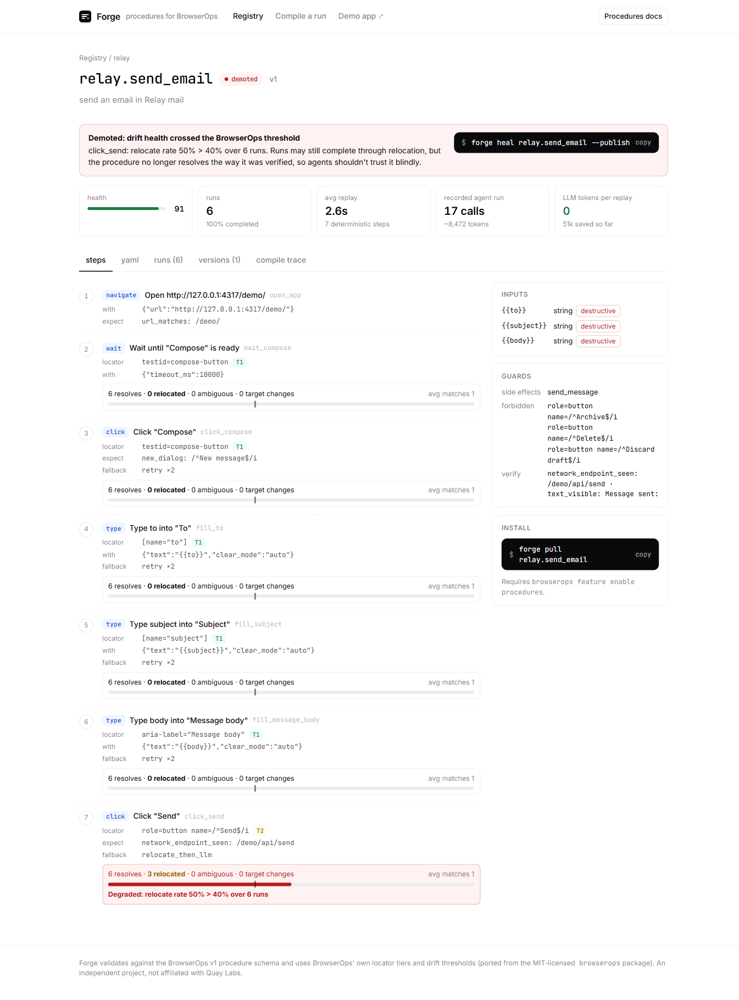 40% over 6 runs" width="900">
</p>

### 4. Heal: a new version that has to re-earn trust

`forge heal` replays against the live page and re-proposes a locator for every step that relocated. The result is published as **v2**, starts as `draft`, and becomes `trusted` again only after three clean strict runs.

| Version history | Run history |
|---|---|
| 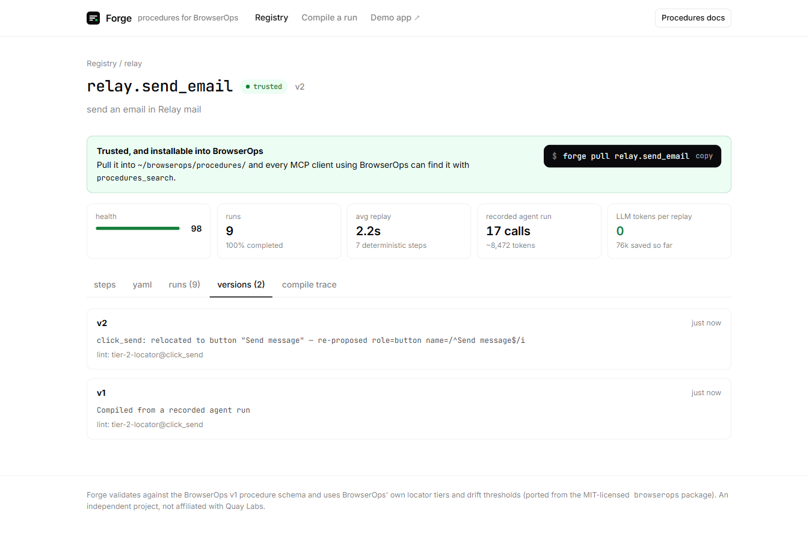 | 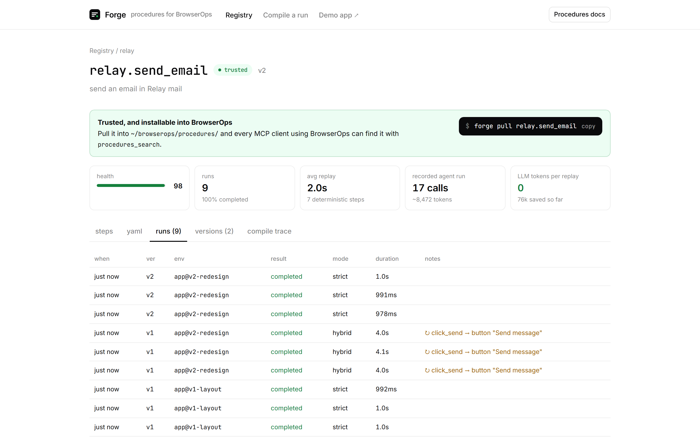 |

## How it works

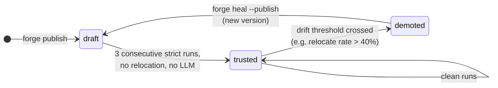

### Compile: one trajectory in, one procedure out &nbsp;·&nbsp; `packages/core`

Input is either a Forge JSONL trajectory or **a raw MCP JSON-RPC transcript** of `tools/call` messages. Any MCP client or proxy can capture the latter, and text a11y trees with `[ref=N]` markers are parsed too. The compiler makes one pass over the calls:

| Pass | What happens | Grounded in |
|---|---|---|
| Drop observations | `browser_read`, `screenshot`, `quick_read`, `list_tabs` … are dropped | teach skill: *"the executor auto-calls browser_read before every browser_locate"* |
| Drop failed and no-op actions | errors, stale refs, and clicks whose `page_effect` is zero | docs: *"clicked: true means dispatched; page_effect changed means the page reacted"* |
| Collapse retries | a retyped field supersedes the earlier attempt; consecutive navigations collapse | |
| Propose locators | each `ref` becomes the smallest unique locator against the snapshot it came from, tier 1 first | `FIELD_TIERS` (ported) |
| Anchor names | `name: "/^Send$/i"`, so it can't match "Schedule send" | teach skill "Don'ts" |
| Lift inputs | typed literals become `{{to}}`, `{{subject}}` …; sample values never reach the YAML | |
| Derive `expect` | from observed effects: `new_dialog`, `network_endpoint_seen`, `url_matches`, `dom_removed_min` | teach skill §9, "reliable predicates" |
| Entry-step pattern | `navigate → wait(entry control) → click` | teach skill §3 |
| Safety | infers `side_effects`, marks inputs `destructive: true`, adds `forbidden.locators` for Delete/Discard/Archive seen on the page | teach skill §3 schema rules |
| `verify{}` | the endpoint of the final submitting action, plus status/alert text that appeared after it | |
| Validate and lint | the BrowserOps v1 JSON Schema (ported), plus 15 lint rules taken from the teach skill's failure modes | |

<details>
<summary><b>Example output</b> (<code>fixtures/relay.send_email.yaml</code>, abridged)</summary>

```yaml
schema_version: 1
name: relay.send_email
kind: leaf
goal: send an email in Relay mail
side_effects: [send_message]
inputs:
  to:      { type: string, required: true, destructive: true }
  subject: { type: string, required: true, destructive: true }
  body:    { type: string, required: true, destructive: true }
forbidden:
  locators:
    - { role: button, name: /^Archive$/i }
    - { role: button, name: /^Delete$/i }
    - { role: button, name: /^Discard draft$/i }
verify:
  network_endpoint_seen: /demo/api/send
  text_visible: "Message sent:"
steps:
  - id: open_app
    do: navigate
    with: { url: http://127.0.0.1:4317/demo/ }
    expect: { url_matches: /demo/ }
  # … wait_compose (wait for the same testid) …
  - id: click_compose
    do: click
    locator:                                      # tier 1
      data_testid: compose-button
      role: button                                # role + exclusion name: lets the runtime's
      name: /^(?!.*(?:Archive|Delete|Discard draft)).*$/i   # static forbidden guard prove it's not Archive/Delete
    expect: { new_dialog: /^New message$/i }
    fallback: { strategy: retry }
  # … fill_to, fill_subject, fill_message_body …
  - id: click_send
    do: click
    locator: { role: button, name: /^Send$/i }    # tier 2: depends on visible copy
    expect: { network_endpoint_seen: /demo/api/send }
    fallback: { strategy: relocate_then_llm }
```

</details>

### Run: deterministic executor with the fallback ladder &nbsp;·&nbsp; `packages/runner`

A Playwright-based executor that uses the same locator-resolution code as the compiler:

- **Auto-prime and auto-wait.** It takes a fresh snapshot before every locator step. Refs are content-stable, so `target_changed` means the element really moved.
- **Fallback ladder.** `strict | retry | relocate | relocate_then_llm | llm`. Relocation widens the locator and ranks candidates by similarity. An LLM rung **halts with `needs_llm`** (where `procedures_resume` would take a patch) instead of pretending.
- **`forbidden{}` is enforced on every dispatch, including relocated targets.**
- **Observation contract.** It measures DOM mutations, URL, focus, network endpoints and new dialogs around each action, and emits BrowserOps-shaped `page_effect` / `effect` envelopes.
- **Heal.** It replays the procedure against the live page and re-proposes a locator for every step that had to relocate, producing a new version that has to re-earn trust.

### Share: registry with earned trust &nbsp;·&nbsp; `apps/hub`

The server uses `node:http` and `node:sqlite` (no native dependencies), with a React UI.

- **Trust is computed server-side, never uploaded.** Every published version starts as `draft`. It becomes `trusted` after **3 consecutive strict runs that complete with no relocation and no LLM fallback**, which is the `browserops-teach` promotion rule.
- **Drift health uses BrowserOps' thresholds**, ported from `src/procedures/health.ts`: relocate rate > 40% over ≥ 5 runs, target changed after ≥ 3 runs, or a tier-3 locator relocating more than 10% of the time leads to **demoted, with a reason**.
- **Search** uses the same tokenizer and stop words as `procedures_search`, so a query that finds a procedure locally also finds it in the Hub.
- `forge pull <name>` writes into `~/browserops/procedures/`, where BrowserOps agents can pick it up.

## Architecture

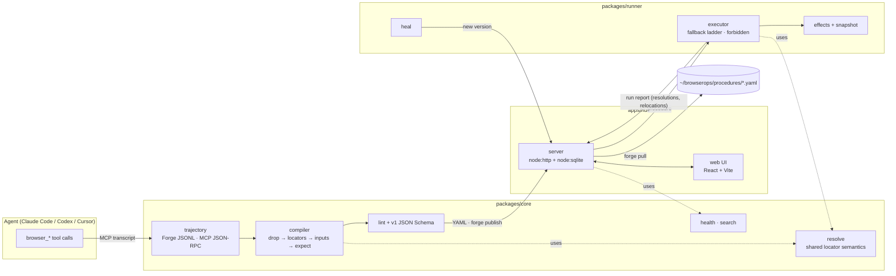

The key design choice is that **the compiler and the runner share `core/resolve`**. The locator the compiler proposes is resolved by exactly the same code at replay time, so "compiles clean" means "replays clean" on the page it was recorded from.

The lifecycle as a sequence:

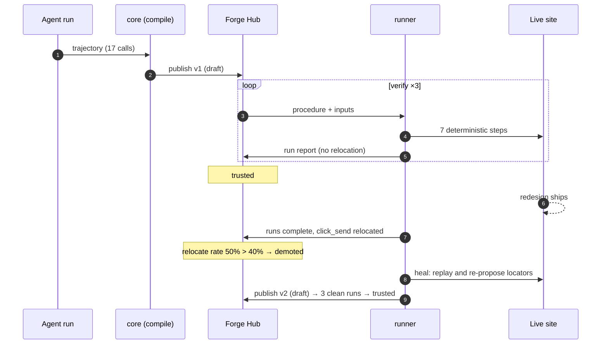

### Repository layout

```
packages/core     schema · locator tiers · trajectory adapters · compiler · linter · health · search
packages/runner   snapshot · effect measurement · recording tools · executor · heal
packages/cli      forge CLI
apps/hub          server (node:http + node:sqlite) · web (React + Vite)
apps/demo         Relay Mail: target app with a v1 layout and a v2 "redesign" at the same URL
fixtures/         sample trajectories and a compiled procedure
scripts/demo.ts   end-to-end lifecycle
docs/images/      README screenshots
```

## CLI

```bash
forge compile run.jsonl --name gmail.send_email   # trajectory → YAML + lint report
forge lint    procedure.yaml
forge publish procedure.yaml
forge search  sending emails
forge pull    relay.send_email                     # → ~/browserops/procedures/
forge run     relay.send_email -i to=me@x.com -i subject=hi -i body=… --strict
forge heal    relay.send_email -i … --publish
```

Inside the repo, use `npm run forge -- <cmd>`.

## Why I built this

I read all of browserops.ai: the docs, the FAQ and the ten blog posts. I also read the published `browserops` / `@browserops/bridge` npm packages (MIT), including the `browserops-teach` skill and the procedure runtime. Two problems kept coming up in your own writing:

> "The biggest limitation today is the teaching process. Creating a procedure is still largely slow and explicit, and it currently takes around 5–10 minutes … We're actively working on an engine that can perform this learning process automatically in the background."
> — *Token Consumption Is Killing Your Browser Agent*

> "The real opportunity isn't creating procedures. It's sharing them. Imagine a global, open repository of verified browser procedures."
> — same post

Forge is my attempt at both:

1. **Background teaching.** When an agent finishes a task, the work of discovering the flow is already in its tool-call history. Forge turns that history into a procedure with no extra agent turns.
2. **A shared registry.** Forge Hub stores procedures, but it only marks one *trusted* after it has seen verified runs, and it demotes procedures that drift, using the same thresholds as your runtime.

## Tested on the live runtime

I first built Forge against the public docs and the published npm packages. Then I installed BrowserOps 0.0.11 (WSL2, with the Chrome extension paired) and ran the whole loop on it. A real agent (Claude Code) did the task through the `browserops` MCP tools. I exported the tool calls from the session transcript, compiled them with Forge, and replayed them with BrowserOps' own `procedures_execute`.

```bash
npx tsx scripts/claude-session-to-mcp.ts ~/.claude/projects/<project>/<session>.jsonl > run.mcp.jsonl
npm run forge -- compile run.mcp.jsonl --name relay.send_email
```

**Result:** 10 live calls → 7 steps. In strict mode on BrowserOps' runtime, the procedure completed **3 of 3 runs, every step `first_try`, with no LLM**, and the server received all three emails. On the v2 redesign, the `data_testid` Compose step still resolved first try. The copy-based Send step drifted, so the runtime escalated to `needs_assist`, and a `procedures_resume` patch completed the run. The recorded run and the compiled procedure are in [`fixtures/relay-send-email.live.mcp.jsonl`](fixtures/relay-send-email.live.mcp.jsonl) and [`fixtures/relay.send_email.live.yaml`](fixtures/relay.send_email.live.yaml). You can load the live run in the Hub with **Compile a run → Load: Live BrowserOps run (MCP)**.

<p align="center">
  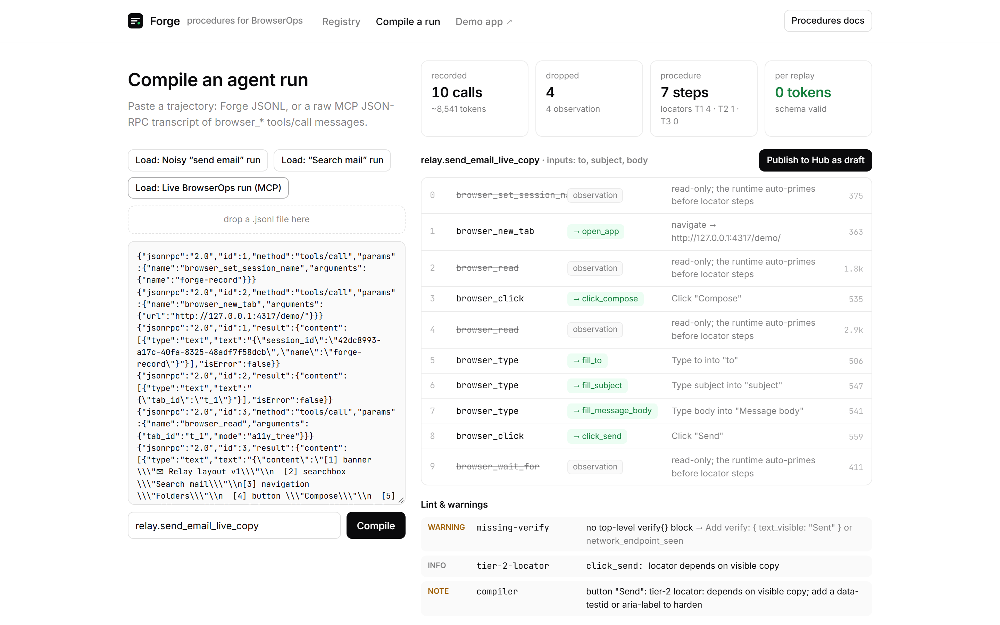
</p>

**The first live compile produced 0 steps.** Forge's own fixtures had encoded Forge's assumptions, so these gaps only showed up against the real runtime:

| Found on the live runtime | Fix in Forge |
|---|---|
| `browser_read` returns `{content, refs[]}`, and `content` uses `[N] role "name"` | The adapter reads both |
| `dialog.showModal()` and typing into an `<input>` cause zero DOM mutations, so Forge dropped real actions as no-ops | `effect.focus_moved_to` and `typed > 0` now count as page effects |
| Agents open the app with `browser_new_tab {url}` | Treated as the entry navigation |
| The forbidden guard checks the step's **descriptor** statically and compares only `role` and `name` | Ported verbatim (`forbiddenOverlaps`) and enforced by a new `forbidden-collision` lint error. Colliding steps get the target's `role`, plus an exclusion `name` (`/^(?!.*(?:Archive\|Delete)).*$/i`). That passes the guard without making the locator depend on copy, so `data_testid` still survives a redesign. |
| A validation toast (*"Add a recipient"*) satisfies `dom_added_min`, so a failed send reported `completed: true` | A submit inside a surface opened earlier must show that surface closed (`text_invisible`) |
| `strict` refuses **every** fallback, relocation included | Forge's runner now does the same. Trust needs strict runs, and drift shows up in non-strict runs. |

### Real sites: TodoMVC and Wikipedia

The same pipeline (agent run through BrowserOps → export → compile → `procedures_save` → strict `procedures_execute`) on two third-party sites:

| Site | Recorded | Compiled | On the BrowserOps runtime |
|---|---|---|---|
| [TodoMVC (React)](https://todomvc.com/examples/react/dist/): add a todo | 10 calls | 4 steps: open → wait for input → type → Enter, all tier 1 (`data-testid`) | **3 of 3 strict runs completed**, every step `first_try`, no LLM |
| Wikipedia: search → open the matching article | 7 calls | 5 steps; the result link is `{role: link, name: /^{{search}}$/i}` | Steps 1–4 passed with a query the recording never saw ("Grace Hopper"), and `{{search}}` was substituted in the locator. That run exposed the two-Search-buttons ambiguity, now fixed. The 3 strict runs are still pending: the extension hit issue 3 again. |

Recordings and compiled procedures: [`todomvc-add-todo.live.mcp.jsonl`](fixtures/todomvc-add-todo.live.mcp.jsonl) → [`todomvc.add_todo.live.yaml`](fixtures/todomvc.add_todo.live.yaml), [`wikipedia-search.live.mcp.jsonl`](fixtures/wikipedia-search.live.mcp.jsonl) → [`wikipedia.search.live.yaml`](fixtures/wikipedia.search.live.yaml). Export one site's calls with `--session <name>`, which slices the transcript on `browser_set_session_name`.

What the real sites exposed in Forge, all fixed and covered by tests:

| Found on | Problem | Fix |
|---|---|---|
| TodoMVC | Live `browser_press` sends `keys: ["Enter"]`, so Forge compiled "Press undefined" | The compiler and Forge's runner read `keys` (`Primary` → `ControlOrMeta`) |
| TodoMVC | A React app renders after load | The entry `wait` step now also comes before a first *type* step |
| Wikipedia | The result to click is named after the query, so a copied locator replays "Ada Lovelace" forever | Typed values that reappear are lifted to `{{search}}` in locators (BrowserOps substitutes there) and generalized to `.+` in expects (it doesn't). Ids and goals no longer contain sample text. |
| Wikipedia | Two "Search" buttons page-wide; uniqueness had only been checked inside a read scoped to the form | Prefer the form's `type=submit` button; warn when a read was scoped |
| Wikipedia | A result's thumbnail and title are two links to the same `href` | Equivalent links → `nth: 0` |
| Wikipedia, [messy first attempt](fixtures/wikipedia-messy.live.mcp.jsonl) | A read too large for the client replaced the runtime's refs, but the transcript doesn't show them. The next type and click hit unknown elements. | Refs after a ref-defining read with no captured snapshot are unknown, and actions using them are dropped as unreplayable. A failed run doesn't become a fake procedure. |

**Issues in BrowserOps 0.0.11 itself** (reproduced, with log lines and source locations):

1. **The forbidden guard rejects locators BrowserOps itself proposes.** `browser_propose_locator` returns `{data_testid: "compose-button"}`. `locatorOverlaps` (bridge `procedures/forbidden.ts`) treats any descriptor without `role` and `name` as overlapping, so a `{role: button, name: /^Archive$/i}` entry under `forbidden` blocks it.
2. **`clear_mode: "auto"` clears the previously focused field.** It clears `document.activeElement` *before* it focuses the target. Repro: type into `to`, then type into `subject` with `clear_mode: "auto"`, and `to` ends up empty.
3. **`browser_navigate` replies arrive one navigation late.** On a fast local page, the reply comes back as an `orphan` only when the *next* navigation starts, so the first call times out at 45 s. `wait_for_load: false` and `observe_effects: false` don't help. Reloading the extension clears it for a while.
4. **Relocation adds `has_text: "click"`**, which seems to come from the step's verb, so `widen_name` can't match the renamed button.
5. **`procedures_resume`** expects `{kind: "resume_with", with: {locator}}`. The tool description reads like `{kind, locator}`, and that form is silently ignored.
6. **Locator `near` is accepted but ignored.** `{role: button, name: /^Search$/i, near: {locator: <search box>, radius_px: 250}}` returns the same 2 matches as without `near`.
7. **Smaller detection gaps.** A default `scope: "viewport"` read returns an empty tree on TodoMVC, while `scope: "document"` returns 23 nodes. A click that navigates (Wikipedia's search button) reports `url.changed: false`. `data:` URLs show up in captured endpoints as `nullimage/svg+xml,…`. One navigate failed with `INTERNAL: Navigation rejected`.

The full write-up, with repro steps and suggested fixes, is the separate bug report.

## Honest notes

- Locator tiers, drift thresholds, the schema and the tokenizer are ported from the MIT-licensed BrowserOps packages (attribution in `packages/core/src/schema.ts`). The Playwright-based demo (`npm run demo`) still uses a scripted stand-in agent so it can run offline. The live run above used a real one.
- **Token counts are estimates** (about 4 characters per token, plus a per-turn floor) unless a transcript carries `usage`.
- The runner implements the fallback ladder up to relocation. The `llm` rung deliberately halts with `needs_llm` rather than faking a patch.
- `near`, `in_frame` and `procedure_call` (composites) are validated by the schema but not executed by the Forge runner yet.

## What I'd build next

1. **Compile inside the daemon.** The daemon already sees every tool call and every `page_effect`. A post-task hook could run the compiler, verify in strict mode against the safe-dummy registry, and save drafts automatically. That would be the background teaching engine from the blog post.
2. **Signed, privacy-checked publishing.** Procedures cross user boundaries in a shared registry. Forge already keeps typed values out of the YAML. Next would be scrubbing URLs, IDs and emails from locators (there is a lint rule for hardcoded identities), plus signing.
3. **Fleet-level drift.** When 50 users run `gmail.send_email`, the registry sees a redesign before any single user does, and can heal once for everyone.

---

<sub>Independent project, not affiliated with Quay Labs. Built as a take-home for the BrowserOps full-stack internship.</sub>
